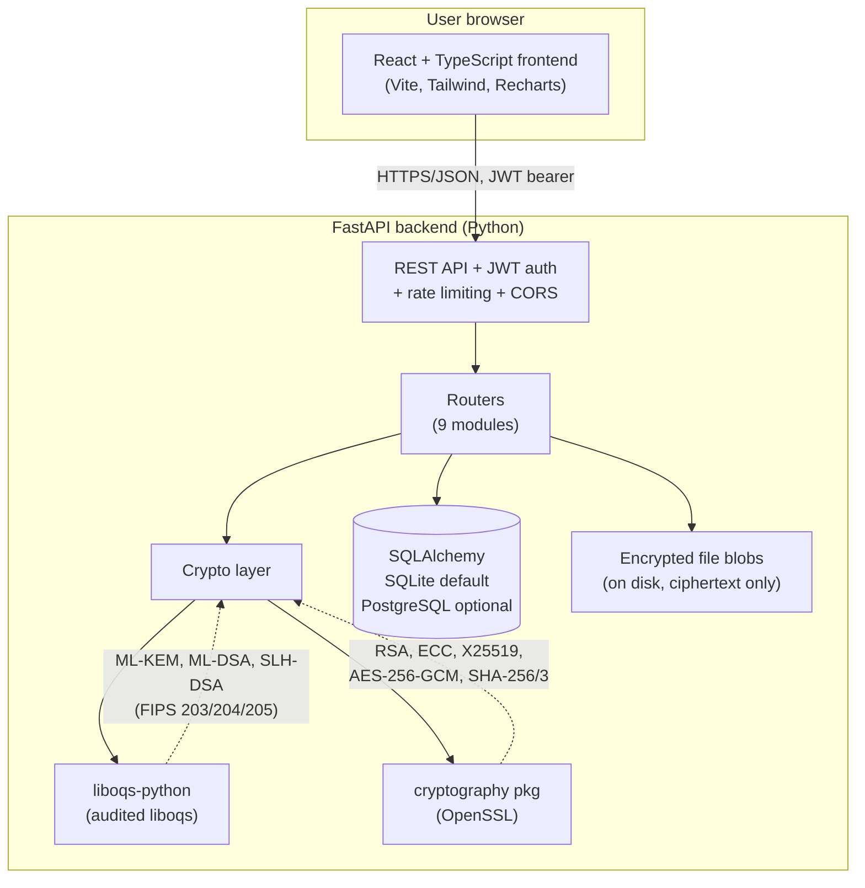

# QUANTUMSHIELD X — Architecture

## System diagram

## Request flows

### ML-KEM roundtrip (lab)
1. `POST /api/keys/generate` (ML-KEM-768) → liboqs generates a keypair.
   The private key is returned **once** and never stored.
2. `POST /api/kem/encaps` with the public key → liboqs encapsulates.
   The response carries the ciphertext and a **SHA-256 commitment** of the
   shared secret — never the secret itself.
3. `POST /api/kem/decaps-verify` with the private key + ciphertext →
   liboqs decapsulates, the server hashes the secret and compares it to the
   commitment, returning only `match: true/false`.

### Secure message
1. Sender publishes ML-DSA-65 public key; recipient publishes ML-KEM-768
   public key (public keys are the only key material stored).
2. Send: server signs the plaintext with the sender's pasted ML-DSA private
   key, encapsulates a fresh secret against the recipient's public key,
   derives an AES-256-GCM key via HKDF, encrypts, and stores **ciphertext
   only** (KEM ciphertext + nonce + ciphertext + signature).
3. Recipient decrypts by pasting their ML-KEM private key (used in memory
   only), then verifies the signature against the sender's stored public key.

### File encryption
Same pattern as messaging, with a random per-file AES key wrapped by ML-KEM:
`HKDF-SHA256(ML-KEM secret) → AES-256-GCM key`. The encrypted blob is stored
on disk; SHA-256 + SHA3-256 of the original are stored for integrity checks.
Signing a file signs the decrypted bytes with ML-DSA/SLH-DSA.

### Hybrid mode
`HKDF-SHA256(X25519 secret ‖ ML-KEM-768 secret) → AES-256-GCM key`.
Security assumption (also returned by the API): secure if **either**
component holds. This is the standard hybrid KEM combiner construction.

### Audit chain
`entry_hash = SHA-256(prev_hash ‖ canonical(actor, action, details))`,
starting from a fixed genesis hash. `/api/audit/verify-chain` recomputes every
link; any edited, deleted, or inserted row breaks it.

## Database schema (SQLite / PostgreSQL)

| Table | Key columns | Notes |
|---|---|---|
| users | id, username (unique), password_hash (bcrypt), role, kem_public_key, dsa_public_key | No private keys, ever |
| crypto_operations | id, user_id, operation, algorithm, success, created_at | Dashboard source of truth |
| messages | id, sender_id, recipient_id, kem_ciphertext, nonce, ciphertext, signature, sender_dsa_public_key | Ciphertext only |
| files | id, owner_id, original_name, stored_name, size_bytes, sha256, sha3_256, kem_ciphertext, nonce, signature, signature_algorithm, signer_dsa_public_key | Blobs on disk, encrypted |
| audit_log | id, actor, action, details, prev_hash, entry_hash | Hash-chained |

## Trust boundaries

- The browser holds the JWT and any pasted private keys (session only, never
  in localStorage except the JWT). Private keys pasted into forms are sent
  over the API call and used in server memory only.
- The server never persists private keys, shared secrets, or plaintext
  messages/files. It never logs them either.
- The database holds public keys, ciphertext, hashes, and operation metadata.
- liboqs and OpenSSL are the only cryptographic implementations; no
  algorithm is implemented by hand in this codebase.

## What is NOT real (honest list)

- The quantum simulator and HNDL estimator are **educational models**, not
  measurements of real quantum hardware or predictions.
- Benchmark timings are real measurements, but they describe this server's
  hardware, not a general performance claim.
- No independent security audit or certification has been performed.
